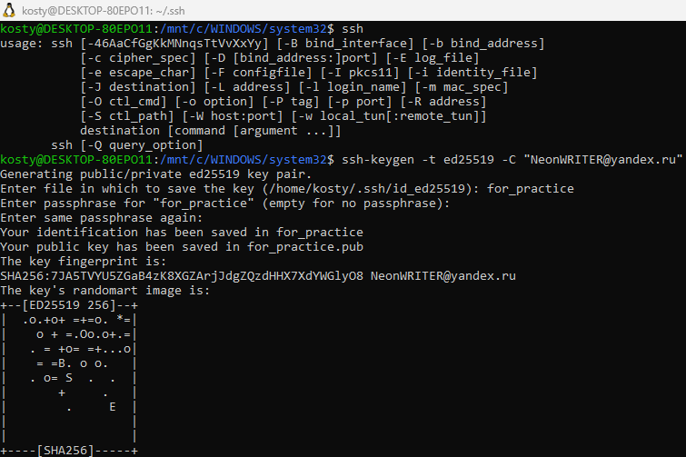
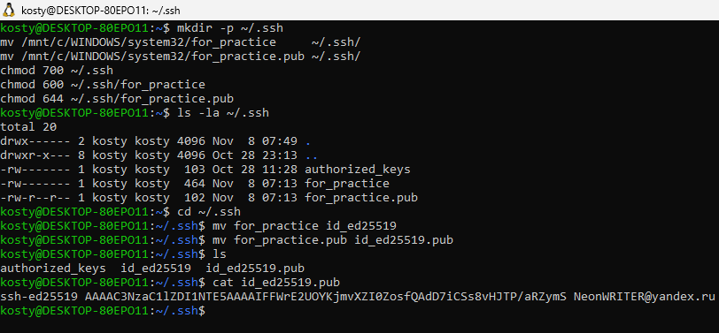
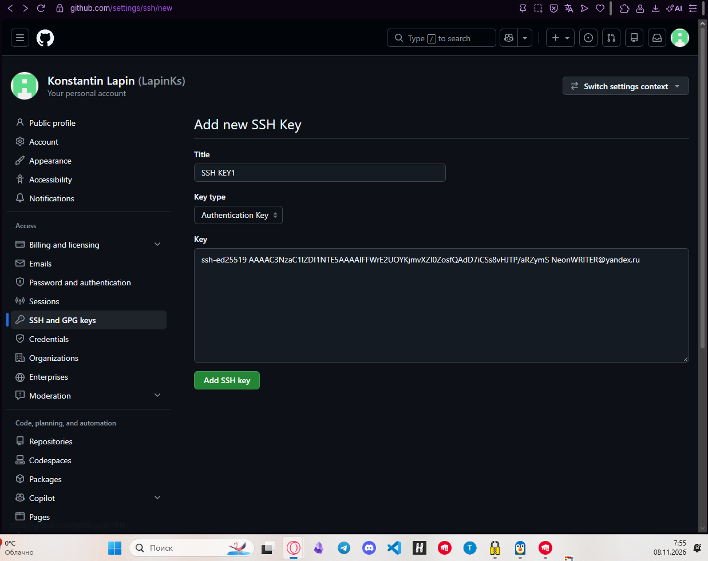
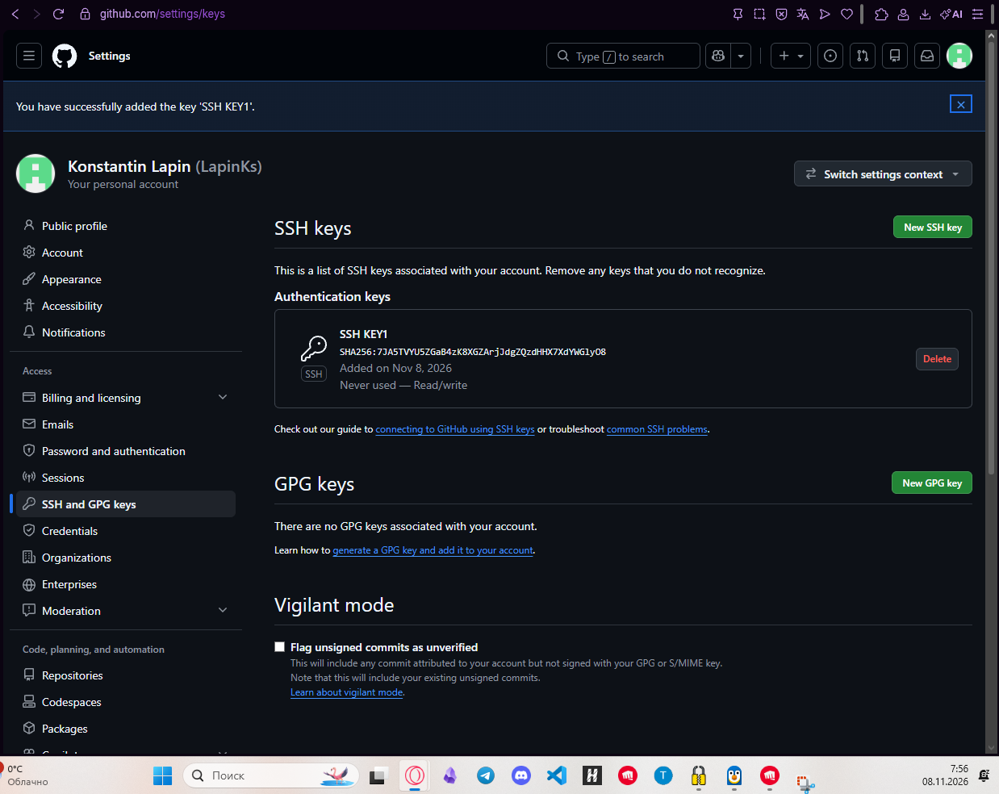
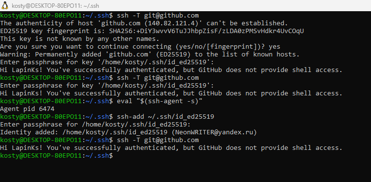
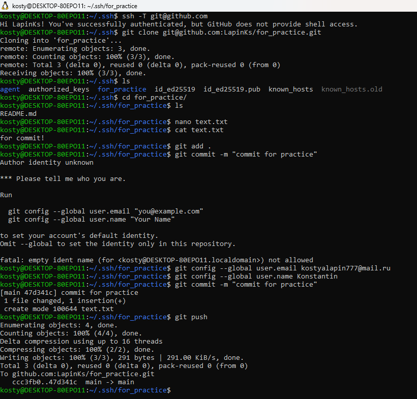

## Установка SSH-клиента и генерация ключевой пары
Проверить наличие SSH-клиента в системе, сгенерировать новую пару ключей (рекомендуется ed25519), убедиться, что приватный ключ защищён паролем (passphrase), а публичный ключ сохранён в ~/.ssh/.

проверяем, что ssh имеется и функционирует, затем генерируем пару ключей, именуя файл для них как "for_practice"

далее перемещяем ключи в нужную директорию - ssh - и переименовывем их

## Добавление публичного ключа в аккаунт GitHub
Скопировать содержимое ~/.ssh/id_ed25519.pub и добавить его в настройках GitHub (Settings - SSH and GPG keys). Приложить скриншот/подтверждение.

Добавляем публичный ключ из файла

Результат добавления ниже

## Проверка SSH-подключения к GitHub
Выполнить ssh -T git@github.com и убедиться, что соединение устанавливается без пароля и возвращается приветствие от GitHub.

подсоединяемся к github с запросом ключа, затем создаем агента, и оттаем ему ключ для безпарольного соединения, проверяем подключение

## Работа с репозиторием по SSH
Клонировать любой свой репозиторий по SSH-URL (git@github.com:user/repo.git), создать коммит и выполнить git push — убедиться, что операция проходит без ввода пароля (используется ключ).

Создаем пустой репозиторий, результат создания ниже

Клонируем репозиторий, создаем текстовый файл и редактируем его, результат этого действия выведет через cat/ Затем добавляем в конфиг git-а email и имя и пушим изменения из локального репозитория

Результат пуша ниже

В ходе этой практики мы научились создавать ключи с помощью ssh-keygen, устанавливать соединение с git с локальной машины без пароля, попрактиковались в клонировании и пуше изменений в удаленный репозиторий, и приобрели небольшой опыт работы с .md файлами
