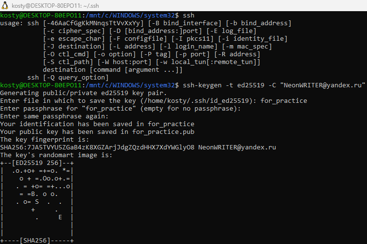
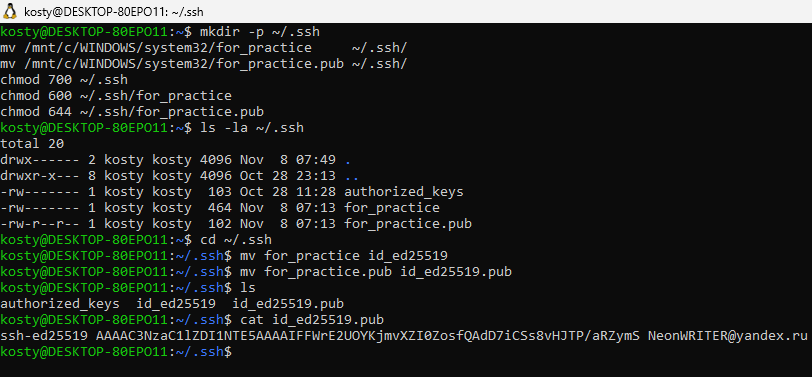
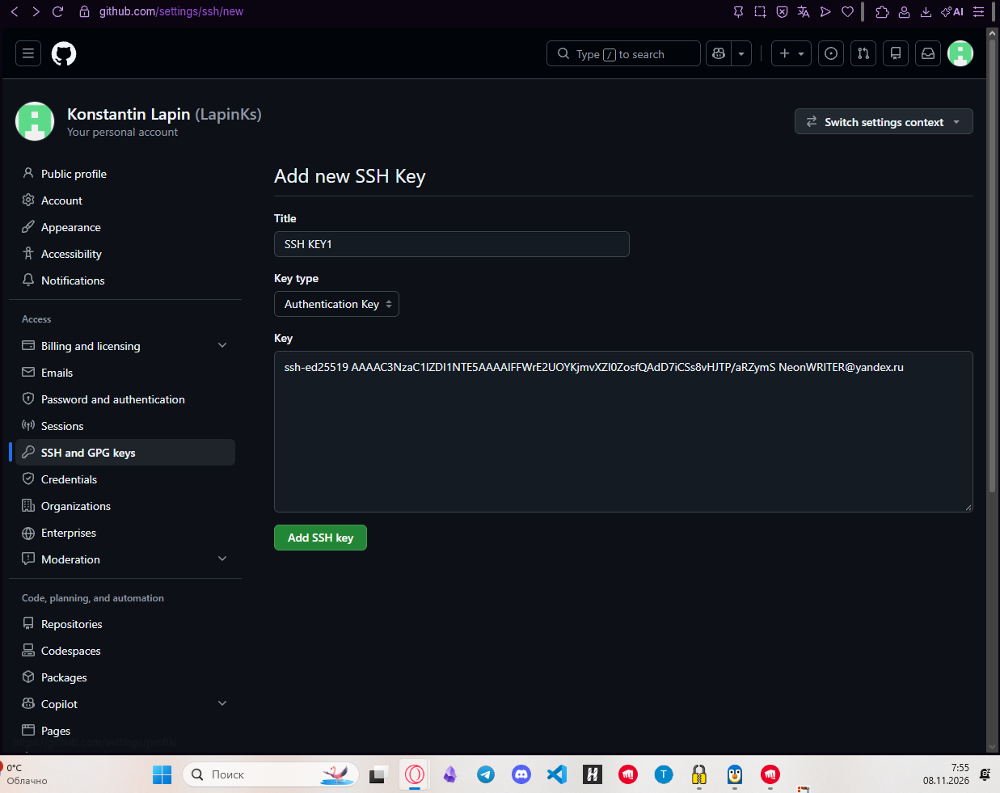
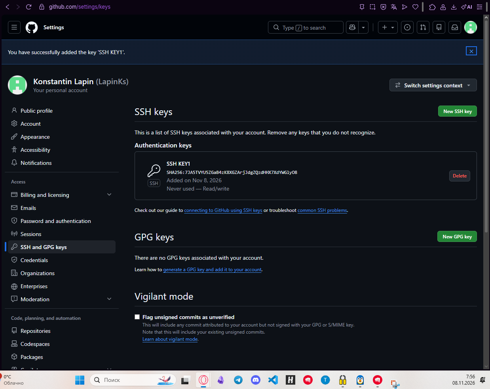
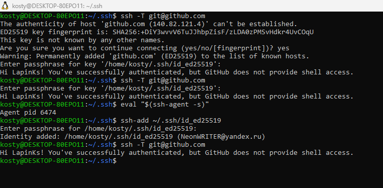
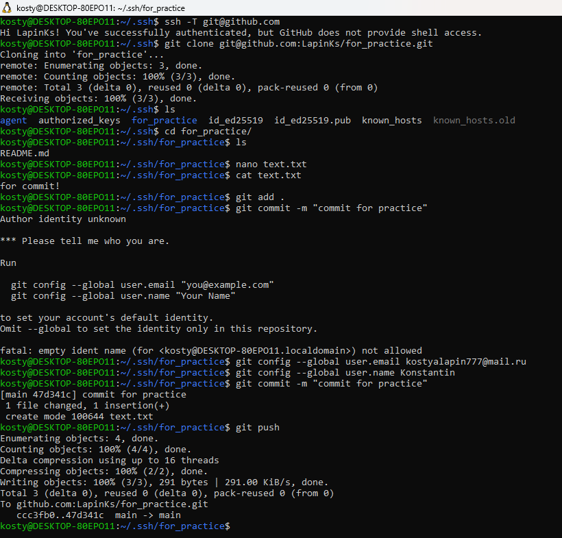

## Установка SSH-клиента и генерация ключевой пары
Проверить наличие SSH-клиента в системе, сгенерировать новую пару ключей (рекомендуется ed25519), убедиться, что приватный ключ защищён паролем (passphrase), а публичный ключ сохранён в ~/.ssh/.

## Добавление публичного ключа в аккаунт GitHub
Скопировать содержимое ~/.ssh/id_ed25519.pub и добавить его в настройках GitHub (Settings - SSH and GPG keys). Приложить скриншот/подтверждение.

## Проверка SSH-подключения к GitHub
Выполнить ssh -T git@github.com и убедиться, что соединение устанавливается без пароля и возвращается приветствие от GitHub.

## Работа с репозиторием по SSH
Клонировать любой свой репозиторий по SSH-URL (git@github.com:user/repo.git), создать коммит и выполнить git push — убедиться, что операция проходит без ввода пароля (используется ключ).

